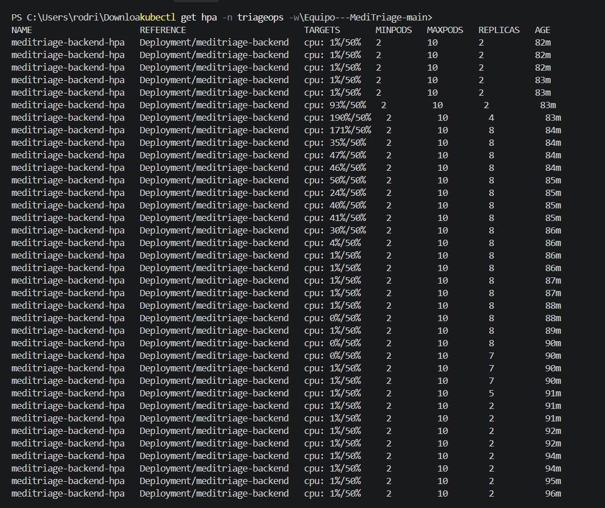
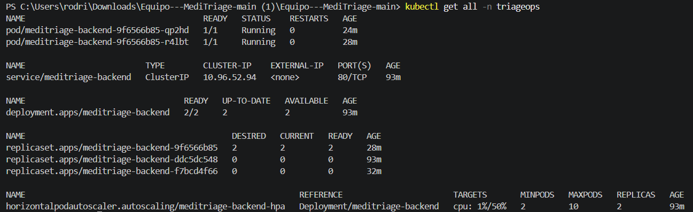
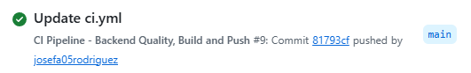
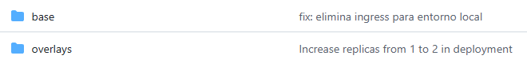
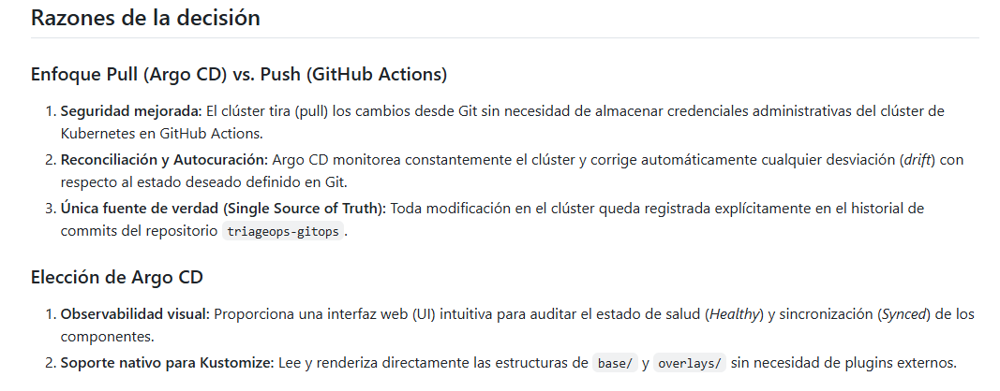
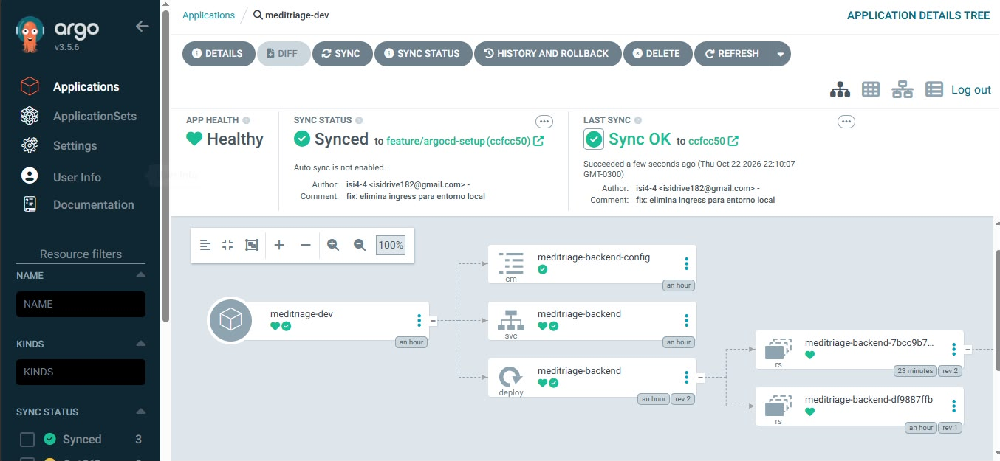
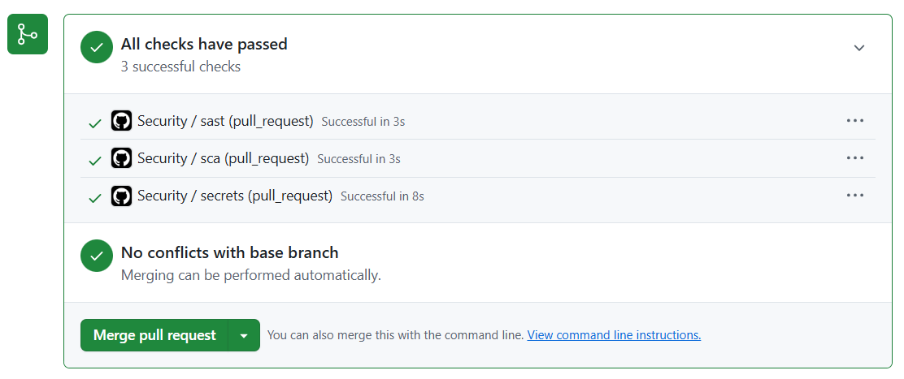

# Equipo---MediTriage

## 🛠️ Configuración del Entorno de Desarrollo Local

Sigue estos pasos para clonar el repositorio, configurar el entorno virtual de Python e instalar las dependencias necesarias para trabajar en el backend.

### Prerrequisitos

* **Git** instalado en el sistema.
* **Python 3.11+** instalado (asegúrate de marcar la casilla *"Add Python to PATH"* durante la instalación).

---

### 1. Clonar el Repositorio

Abre tu terminal y clona el proyecto:

```bash
git clone <URL_DEL_REPOSITORIO>
cd Equipo---MediTriage
```

---

### 2. Navegar al Backend

Toda la lógica y dependencias de la API residen en la carpeta backend:

```bash
cd backend
```

---

### 3. Crear el Entorno Virtual

Crea un entorno virtual aislado para evitar conflictos de librerías:

#### En Windows (PowerShell / CMD):

```powershell
python -m venv venv
```

#### En macOS / Linux:

```bash
python3 -m venv venv
```

---

### 4. Activar el Entorno Virtual

#### En Windows (PowerShell):

```powershell
.\venv\Scripts\Activate.ps1
```
*(Nota: Si PowerShell arroja un error de ejecución de scripts, ejecuta primero `Set-ExecutionPolicy -Scope Process -ExecutionPolicy Bypass` y vuelve a intentar).*

#### En Windows (Git Bash):

```bash
source venv/Scripts/activate
```

#### En macOS / Linux:

```bash
source venv/bin/activate
```

Sabrás que está activo porque aparecerá `(venv)` al inicio de la línea en tu terminal.

---

### 5. Instalar Dependencias

Actualiza el gestor de paquetes e instala las librerías del proyecto:

```bash
python -m pip install --upgrade pip
pip install -r requirements.txt
```

---

### 6. Ejecutar el Servidor en Modo Desarrollo (HTTP Base)

Inicia el servidor local con recarga automática:

```bash
uvicorn app.main:app --reload --port 8000
```

* **API Base:** `http://localhost:8000`
* **Health Check:** `http://localhost:8000/api/v1/health`
* **Documentación Interactiva (Swagger):** `http://localhost:8000/docs`

---

### 7. Ejecutar Pruebas Automatizadas

Para validar que todo funciona correctamente y comprobar la cobertura de código:

```bash
pytest
```

---

## 🔒 Configuración de Seguridad y TLS (DevSecOps)

Una vez completados los pasos de instalación base, es obligatorio configurar el entorno de desarrollo local con conexiones cifradas (HTTPS/TLS) para cumplir con los estándares del proyecto.

### 1. Protección de Base de Datos y PII
*   **Cifrado de Datos (PII):** La base de datos tiene habilitada la extensión `pgcrypto` para encriptar campos de información personal.
*   **Conexión TLS requerida:** La variable `DATABASE_URL` en el archivo `docker-compose.yml` ya incluye el parámetro `?sslmode=require`. Esto obliga a que la comunicación entre la API y PostgreSQL viaje completamente encriptada.

### 2. Generar Certificados Locales para la API
Para que la API corra bajo HTTPS en local, instala `mkcert` (abre PowerShell como administrador para esta primera vez):

```powershell
winget install mkcert
mkcert -install
```

Luego, abre una terminal normal, asegúrate de estar en la carpeta del backend y genera tus llaves de seguridad:

```powershell
cd backend
mkcert localhost 127.0.0.1
```
*(Nota: Se crearán los archivos `localhost+1.pem` y `localhost+1-key.pem`. Estos nunca deben subirse al repositorio).*

### 3. Levantar el Servidor Seguro (HTTPS)
En lugar del comando del paso 6, arranca el servidor apuntando a las llaves que acabas de crear:

```powershell
uvicorn app.main:app --reload --ssl-keyfile="localhost+1-key.pem" --ssl-certfile="localhost+1.pem"
```
✅ **Verificación:** Ingresa a `https://127.0.0.1:8000/docs`. Deberás ver el candado cerrado en el navegador, confirmando que tu entorno seguro está activo.

## 🔒 Prohibición de Mocks Locales (Dev/prod parity)

Para mantener la consistencia entre los entornos de desarrollo y producción, es obligatorio utilizar los servicios reales definidos en `docker-compose.yml` durante el desarrollo integrado de MediTriage.

### 1. Uso obligatorio de servicios reales

* **PostgreSQL:** Se prohíbe utilizar SQLite o bases de datos en memoria como reemplazo de PostgreSQL.
* **Redis:** Se prohíbe sustituir Redis por diccionarios, variables globales u otros mecanismos de almacenamiento local.
* **Servicios simulados:** No se deben utilizar implementaciones simuladas que oculten errores de conexión o diferencias de comportamiento durante el desarrollo integrado.

### 2. Configuración del entorno de desarrollo

Todos los integrantes del equipo deben utilizar los servicios reales definidos en `docker-compose.yml`, manteniendo una configuración consistente con la infraestructura del proyecto.

Para iniciar los servicios, ejecutar desde la carpeta raíz del proyecto:

```bash
docker compose up -d --build
```

Para verificar el estado de los contenedores:

```bash
docker compose ps
```

Para consultar los registros de ejecución:

```bash
docker compose logs -f
```

### 3. Verificación de PostgreSQL y Redis

Antes de comenzar el desarrollo o las pruebas de integración, se debe comprobar que los servicios estén disponibles.

Para verificar PostgreSQL:

```bash
docker compose exec postgres pg_isready
```

Para verificar Redis:

```bash
docker compose exec redis redis-cli ping
```

✅ **Verificación:** Redis debe responder `PONG` y PostgreSQL debe indicar que acepta conexiones. Los nombres `postgres` y `redis` deben coincidir con los servicios definidos en `docker-compose.yml`.

### 4. Manejo de errores de conexión

* **Variables de entorno:** Verificar que `DATABASE_URL` y `REDIS_URL` tengan los valores correctos.
* **Contenedores:** Comprobar que los servicios estén en ejecución.
* **Configuración:** Revisar credenciales, puertos y redes de Docker Compose.
* **Corrección de errores:** Los problemas de conexión deben solucionarse en el entorno integrado, sin sustituir PostgreSQL por SQLite ni Redis por almacenamiento en memoria.

### 5. Uso de mocks en pruebas

Los mocks pueden utilizarse en pruebas unitarias aisladas cuando sea necesario verificar componentes específicos. Sin embargo, no deben reemplazar PostgreSQL ni Redis durante el desarrollo integrado de MediTriage.

✅ **Criterio de cumplimiento:** Todo el equipo debe ejecutar la aplicación utilizando los servicios reales definidos en `docker-compose.yml`, evitando diferencias de comportamiento entre desarrollo y producción.

---

## 🧪 Servidor Mock de la API (Prism)

Para levantar un servidor mock local basado en el contrato OpenAPI de MediTriage y probar los endpoints antes de desplegar el backend:

```bash
npx @stoplight/prism-cli mock api/openapi.yaml -p 4010
```

---

## Autoescalado (HPA)

El backend se despliega con Kustomize y escala automáticamente según el uso de CPU (mínimo 2 réplicas, máximo 10, objetivo 50%).

Aplicar los manifiestos:

```bash
kubectl apply -k k8s/
```

Probar el HPA con carga sintética (script en `scripts/load/hpa-load.sh`):

```bash
kubectl get hpa -n triageops -w
kubectl run carga -n triageops --rm -it --image=busybox:1.36 --restart=Never -- sh -c "for i in 1 2 3 4 5; do (while true; do wget -q -O- http://meditriage-backend/api/v1/health >/dev/null; done) & done; wait"
```

### Evidencia

En la prueba el HPA subió de 2 a 8 réplicas bajo carga y volvió a 2 al cortarla. Los registros del estado antes, durante y después están en `docs/data/evidencia-hpa/`: `01-antes.txt`, `02-durante.txt` y `03-despues.txt`.

Cambio de réplicas durante la prueba:



Estado final del namespace (`kubectl get all -n triageops`):



**Promoción a producción**

**Decisión**

La promoción a producción será manual mediante Pull Request (PR) en el repositorio triageops-ts/triageops-gitops. El pipeline de la aplicación publica la imagen y actualiza automáticamente solo overlays/dev; no debe modificar overlays/prod.

**Procedimiento de promoción**
1. Confirmar que el workflow de triageops-ts/Equipo---MediTriage terminó correctamente en main y publicó ghcr.io/triageops-ts/meditriage-backend:<commit-sha>.
2. Confirmar que ese tag quedó actualizado en overlays/dev/kustomization.yaml y que Argo CD para dev está Synced y Healthy.
3. Crear una rama en triageops-ts/triageops-gitops y cambiar únicamente la versión de la imagen en overlays/prod/kustomization.yaml al mismo <commit-sha> verificado en dev. No usar latest.
4. Abrir un PR hacia main, enlazando el commit del código y la ejecución verde de CI. Solicitar revisión/aprobación del responsable de producción.
5. Tras aprobar y mergear el PR, esperar a que Argo CD de producción detecte el cambio. Verificar Synced y Healthy, y confirmar que los pods de producción usan el tag aprobado.
6. Registrar en el PR la revisión desplegada y cualquier comprobación posterior al despliegue.

**Reversión**

Si la verificación de producción falla, abrir un PR de reversión que restaure en overlays/prod/kustomization.yaml el último tag conocido como bueno. Después de mergear, comprobar que Argo CD vuelve a sincronizar y que los pods ejecutan esa versión.

**Controles**
- No promover a producción automáticamente desde el job promote de CI.
- Promover exactamente el SHA que ya fue verificado en dev.
- Mantener la aprobación humana y el historial del cambio en el PR de GitOps.
- No guardar tokens ni credenciales en archivos del repositorio.

  ---

## 📸 Evidencia de Integración Continua y GitOps 

A continuación se presenta la evidencia del cumplimiento de los requisitos de GitOps, CI/CD y despliegue automatizado con Argo CD:

### 1. Flujo de CI Exitoso (`ci.yml`)
El flujo de Integración Continua en GitHub Actions ejecuta las pruebas y compilaciones correctamente en la rama `main`.


### 2. Estructura del Repositorio GitOps
El repositorio `triageops-gitops` cuenta con la estructura clara de manifiestos Kustomize dividida en carpetas `base/` y `overlays/{dev,prod}`.


### 3. Registro de Decisión de Arquitectura (ADR)
Documentación formal de la decisión de arquitectura adoptada para la implementación de GitOps y Argo CD.


### 4. Estado del Despliegue en Argo CD (Healthy & Synced)


---

## 🛡️ Seguridad en el pipeline (shift-left)

El workflow [`security.yml`](.github/workflows/security.yml) revisa la seguridad del proyecto en cada Pull Request hacia `main` y en cada push a `main`, antes de que un cambio llegue a producción. También se puede ejecutar a mano desde la pestaña Actions. Tiene tres jobs que corren en paralelo y sin filtros de rutas, por lo que los tres checks aparecen en todos los PRs. Un PR no se puede mergear a `main` mientras alguno de los tres falle.

### Qué revisa cada job y cuándo falla

| Job | Herramienta | Qué revisa | Cuándo falla |
|---|---|---|---|
| `sast` | Semgrep, con las reglas `p/owasp-top-ten` y las propias de `.semgrep/` | El código fuente | Cuando Semgrep encuentra un hallazgo |
| `sca` | Trivy 0.76.1 (modo filesystem) | Las dependencias del backend (`backend/requirements.txt`) y del frontend (`package-lock.json`) | Cuando hay una vulnerabilidad HIGH o CRITICAL **con parche disponible** (`--ignore-unfixed`) |
| `secrets` | gitleaks 8.30.0 | **Todo el historial** del repositorio (`fetch-depth: 0`), no solo el último commit | Cuando encuentra un secreto que no está autorizado en `.gitleaks.toml` |

Detalles de cada uno:

- **Reglas propias de Semgrep** (`.semgrep/meditriage-rules.yml`, con sus casos de prueba en `.semgrep/meditriage-rules.py`):
  - `meditriage-pii-en-logs`: ningún dato personal (RUT, nombre, contacto o fecha de nacimiento) puede enviarse a un log.
  - `meditriage-secreto-en-codigo`: los secretos se leen solo de variables de entorno y nunca llevan un valor por defecto.
  - Se verifican con `semgrep --test .semgrep/`.
- **SBOM:** el job `sca` genera el inventario de dependencias en formato CycloneDX (`sbom.json`) y lo publica como el artefacto `sbom` del run. Se descarga desde el resumen del run en la pestaña Actions y se conserva 30 días. Se genera aunque el escaneo de vulnerabilidades falle.
- **Secretos:** las excepciones autorizadas están en `.gitleaks.toml`, cada una con su justificación.

### Cómo re-triar un hallazgo

Re-triar es revisar un hallazgo y decidir qué hacer con él.

1. **Encontrarlo.** Abre el PR, entra a la pestaña Checks (o a Actions), elige el job que falló y lee su log:
   - Semgrep indica la regla y la línea de código.
   - Trivy muestra una tabla con el paquete, la versión instalada, la versión corregida y el identificador (CVE).
   - gitleaks indica la regla, el archivo, el commit y el fingerprint. El valor del secreto sale oculto.
2. **Clasificarlo.** ¿Es real o un falso positivo? ¿Es un valor de ejemplo? ¿El código o el paquete afectado se ejecuta en producción o solo en pruebas? ¿Existe un parche?
3. **Actuar según el caso:**

   | Caso | Qué hacer |
   |---|---|
   | Hallazgo real de Semgrep | Corregir el código y volver a empujar |
   | Falso positivo de Semgrep | Agregar `# nosemgrep: <id-de-la-regla>` en esa línea, con la razón, o ajustar la regla en `.semgrep/` |
   | Vulnerabilidad con parche | Subir la versión en `backend/requirements.txt` (están fijadas) o en el `package-lock.json` del frontend y volver a correr el pipeline |
   | Vulnerabilidad sin parche | No bloquea el pipeline (`--ignore-unfixed`), pero se registra y se revisa cuando exista el parche |
   | Secreto real | **Revocarlo y rotarlo primero** y luego quitarlo del código. Borrarlo del repositorio no basta, porque queda en el historial |
   | Secreto falso (valor de ejemplo o llave local) | Agregar una excepción con su descripción en `.gitleaks.toml`, en el mismo PR |

4. **Dejar registro** en la descripción del PR: qué se encontró, qué se decidió y quién lo decidió.

Si en un PR aparecen hallazgos de severidad High, la descripción del PR debe incluir el plan de remediación o la justificación VEX.

### Cómo solicitar una excepción (VEX)

Una excepción se pide cuando un hallazgo bloqueante no se puede corregir ahora y se puede justificar que no pone en riesgo el sistema. VEX (*Vulnerability Exploitability eXchange*) es la declaración de si una vulnerabilidad afecta realmente al producto.

1. **Abrir un PR** cuya descripción incluya esta solicitud:

   ```markdown
   ## Solicitud de excepción (VEX)
   - Hallazgo: CVE-AAAA-NNNN (Trivy) / id de la regla (Semgrep) / regla de gitleaks
   - Componente y versión: ...
   - Estado VEX: not_affected | affected | fixed | under_investigation
   - Justificación: por qué no es explotable en MediTriage, o cuál es el plan de remediación
   - Vigencia: hasta AAAA-MM-DD
   ```

2. **Registrar la excepción en el mismo PR**, en el archivo que corresponda:
   - Trivy (`sca`): una línea en `.trivyignore`, en la raíz del repositorio, con el identificador y su vigencia, por ejemplo `CVE-AAAA-NNNN exp:AAAA-MM-DD`, con un comentario encima que explique la razón.
   - Semgrep (`sast`): `# nosemgrep: <id-de-la-regla>` en la línea afectada, o la ruta en `.semgrepignore`.
   - gitleaks (`secrets`): una entrada `[[allowlists]]` con su descripción en `.gitleaks.toml`.
3. **Aprobación:** otra persona del equipo, distinta de quien la solicita, revisa y aprueba el PR. La excepción vence en la fecha indicada y debe revisarse o renovarse.

### Evidencia

PR con los tres checks de seguridad pasando:



Documentos relacionados:

- Modelo de amenazas STRIDE: [`docs/threat-model.md`](docs/threat-model.md)
- Reglas propias de Semgrep: [`.semgrep/`](.semgrep/)
- Configuración de gitleaks: [`.gitleaks.toml`](.gitleaks.toml)
- SBOM del último run: artefacto `sbom` en [las ejecuciones de `security.yml`](https://github.com/triageops-ts/Equipo---MediTriage/actions/workflows/security.yml)

